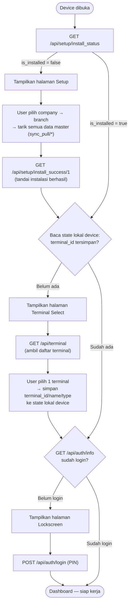

# Gerbang Awal Aplikasi — Detail Teknis (Lengkap)

Versi lengkap dari [GERBANG AWAL APLIKASI (SIMPLE).md](GERBANG%20AWAL%20APLIKASI%20%28SIMPLE%29.md) — tiap gerbang dijelaskan sebagai **endpoint + kondisi + aksi**, buat jadi acuan migrasi ke frontend baru (bukan dokumentasi jejak kode frontend yang sedang berjalan sekarang). Dokumen ini **tidak** menyebut nama file/fungsi frontend spesifik — kontrak di sini berlaku apa pun teknologi frontend-nya nanti.

## Diagram

## 3 Gerbang (Endpoint + Kondisi + Aksi)

### Gerbang 1 — Install

- **Cek status**: `GET /api/setup/install_status` → `{ "data": { "is_installed": true/false } }`.
- **Kondisi**: `is_installed == false` → tampilkan halaman **Setup** (pilih company → pilih branch → tarik semua data master, ±35 endpoint `sync_pull/get_*`, lihat [`SETUP/SETUP WIZARD.md`](SETUP/SETUP%20WIZARD.md)).
- **Setelah sync selesai**: hit `GET /api/setup/install_success/1` — menandai instalasi ini **berhasil** di server (`flag_install_status` jadi `true`). Lanjut ke Gerbang 2.
- **Kondisi**: `is_installed == true` → **skip** halaman Setup, langsung lanjut ke Gerbang 2.

### Gerbang 2 — Terminal Select

- **Cek status**: baca **state lokal device** (lihat "Kontrak Penyimpanan Lokal" di bawah) — apakah `terminal_id` sudah tersimpan.
- **Kondisi**: `terminal_id` **belum ada** → tampilkan halaman **Terminal Select**. Ambil daftar terminal lewat `GET /api/terminal` ([`MASTER/TERMINAL LIST.md`](MASTER/TERMINAL%20LIST.md)), user pilih 1.
- **Setelah user pilih 1 terminal**: simpan `terminal_id`, `terminal_name`, `terminal_type` ke state lokal device. Lanjut ke Gerbang 3.
- **Kondisi**: `terminal_id` **sudah ada** → **skip** halaman Terminal Select, langsung lanjut ke Gerbang 3.

### Gerbang 3 — Login

- **Cek status**: hit `GET /api/auth/info` — kalau `code != 0` atau tidak ada data user, berarti **belum login**.
- **Kondisi**: **belum login** → tampilkan halaman **Lockscreen**, user masukkan PIN lewat `POST /api/auth/login` ([`AUTH/AUTH.md`](AUTH/AUTH.md)).
- **Setelah login berhasil**: masuk ke Dashboard.
- **Kondisi**: **sudah login** → langsung ke Dashboard.

Begitu ketiga gerbang lolos, device langsung ke Dashboard tiap kali dibuka ulang — **kecuali** salah satu kondisinya balik jadi "belum" (kasir logout, atau state lokal device terminal hilang).

## Kontrak Penyimpanan Lokal (WAJIB dipertahankan)

Gerbang 2 (Terminal Select) **bergantung pada state yang disimpan di sisi device/browser**, bukan di server — ini keputusan arsitektur yang harus dipertahankan di frontend baru, bukan detail implementasi yang bebas diganti:

| Key | Isi | Kapan ditulis | Kapan dibaca |
|---|---|---|---|
| `terminal_id` | ID terminal yang dipilih | Sekali, saat user pilih terminal di Gerbang 2 | Setiap kali mau menentukan device ini perlu ke Gerbang 2 lagi atau tidak |
| `terminal_name` | Nama terminal (buat ditampilkan di UI) | Bersamaan `terminal_id` | Ditampilkan di UI, bukan dipakai logic gerbang |
| `terminal_type` | Tipe terminal (POS biasa / Kiosk) | Bersamaan `terminal_id` | Kalau tipe-nya Kiosk, device diarahkan ke bundle/mode Kiosk yang terpisah dari POS biasa — **di luar scope dokumen ini** |

**Kenapa ini harus di state lokal device, bukan di server**: 1 branch bisa punya banyak terminal (beberapa kasir, beberapa meja kasir fisik) — status "device ini sudah pilih terminal yang mana" itu melekat ke **device itu sendiri**, bukan ke akun/sesi kasir yang login (kasir bisa logout-login ganti orang, tapi terminal yang dipakai device itu tetap sama). State ini juga **harus bertahan lintas sesi login** — begitu kasir logout lalu kasir lain login di device yang sama, device itu tidak perlu pilih ulang terminal.

**Konsekuensi kalau state lokal ini hilang** (storage browser di-clear, pindah browser/profil di device yang sama, dst): device "lupa" terminal yang dipilih dan diarahkan balik ke Gerbang 2 — **walau instalasi (Gerbang 1) tidak terdampak sama sekali**, karena status install tersimpan di server, bukan di device.

## Catatan Tambahan

- **`GET /api/setup/install_status`** ditambahkan 2026-10-27 — sebelumnya **tidak ada** cara baca-balik status install dari endpoint khusus (status cuma ditulis lewat `install_success/{status}`, tidak pernah dibaca ulang). Endpoint ini murni baca, tidak ada efek samping.
- Gerbang 2 dan Gerbang 3 **independen satu sama lain** — device bisa punya terminal terpilih tapi belum ada yang login (kasir ganti shift), atau sebaliknya tidak mungkin terjadi (harus pilih terminal dulu sebelum sampai ke tahap login, sesuai urutan di atas).
- Status terminal (Gerbang 2) berlaku untuk **semua halaman** setelah Gerbang 1 lolos — kalau state lokalnya hilang di tengah pemakaian (bukan cuma di awal buka app), device tetap akan diarahkan balik ke Gerbang 2 kapan pun itu terdeteksi.

## Referensi

- [GERBANG AWAL APLIKASI (SIMPLE).md](GERBANG%20AWAL%20APLIKASI%20%28SIMPLE%29.md) — versi ringkas, diagram behaviour.
- [`SETUP/SETUP WIZARD.md`](SETUP/SETUP%20WIZARD.md), [`MASTER/TERMINAL LIST.md`](MASTER/TERMINAL%20LIST.md), [`AUTH/AUTH.md`](AUTH/AUTH.md) — dokumentasi endpoint masing-masing gerbang.
