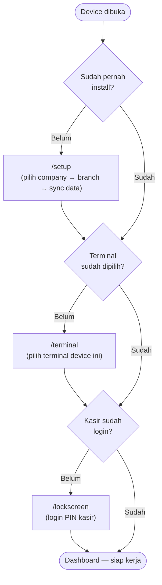

# Gerbang Awal Aplikasi — Behaviour (Simple)

Sebelum kasir bisa login dan mulai kerja, device harus lewat **3 gerbang berurutan**. Dokumen ini jelasin behaviour yang DIALAMI user, tanpa detail kode — buat versi lengkap (file mana ngecek apa) lihat [GERBANG AWAL APLIKASI (LENGKAP).md](GERBANG%20AWAL%20APLIKASI%20%28LENGKAP%29.md).

## Diagram

## Urutan

1. **Setup** (`/setup`) — kalau device ini **belum pernah install** sama sekali: pilih company → pilih branch → tarik semua data master (±35 endpoint `sync_pull/get_*`). Selesai sync, tekan tombol Finish → lanjut ke gerbang 2.
2. **Terminal Select** (`/terminal`) — kalau device **sudah install** tapi **belum pilih terminal**: pilih 1 terminal dari daftar (mewakili 1 kasir/meja kasir fisik di branch itu). Setelah pilih → lanjut ke gerbang 3.
3. **Login PIN** (`/lockscreen`) — kalau terminal **sudah terpilih** tapi **belum ada kasir yang login**: masuk PIN. Setelah berhasil → masuk Dashboard, siap transaksi.

Begitu ketiga gerbang ini lolos, device langsung ke Dashboard tiap kali dibuka ulang (tidak perlu ulang dari gerbang 1) — **kecuali** salah satu kondisinya balik jadi "belum" (misal kasir logout, atau data terminal di device itu ter-reset).

## Referensi

- [`SETUP/SETUP WIZARD.md`](SETUP/SETUP%20WIZARD.md) — detail endpoint gerbang 1.
- [`MASTER/TERMINAL LIST.md`](MASTER/TERMINAL%20LIST.md) — detail endpoint gerbang 2.
- [`AUTH/AUTH.md`](AUTH/AUTH.md) — detail endpoint gerbang 3.
- [`URUTAN IMPLEMENTASI.md`](../URUTAN%20IMPLEMENTASI.md) — urutan Fase 0/1 secara keseluruhan (gerbang ini adalah Fase 0 + awal Fase 1).
